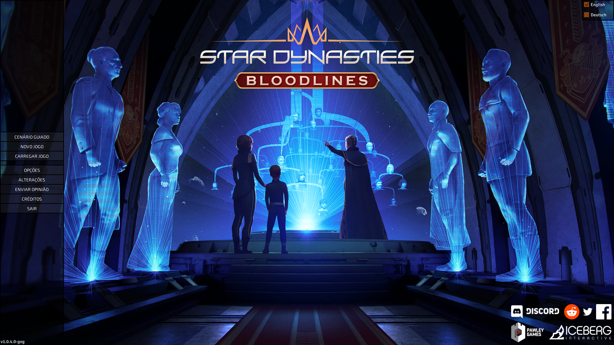

# Teste mínimo do menu em PT-BR

## Resultado confirmado

Em **23/10/2026**, Yuri executou e confirmou o teste mínimo do menu na versão **GOG Windows 1.0.4.0-gog**. A captura fornecida mostra oito botões em português, legíveis e sem cortes aparentes. Os glifos **Á, É, Ã, Õ e Ç** foram renderizados corretamente pela fonte existente; não foi necessário modificar fontes para esta amostra.

| Glifo observado | Exemplo visível |
|---|---|
| Á | CENÁRIO GUIADO |
| É | CRÉDITOS |
| Ã | ENVIAR OPINIÃO |
| Õ | OPÇÕES, ALTERAÇÕES |
| Ç | OPÇÕES, ALTERAÇÕES |

## Escopo da amostra

Foram preparados dez rótulos temporários em `Config/text.csv`, numa cópia separada para teste. O CSV foi reaberto e conferido após a reconstrução. Os oito botões presentes na captura são CENÁRIO GUIADO, NOVO JOGO, CARREGAR JOGO, OPÇÕES, ALTERAÇÕES, ENVIAR OPINIÃO, CRÉDITOS e SAIR.

O título NOTAS DA VERSÃO ({0}) e o botão FECHAR também foram preparados, mas não aparecem nessa captura e continuam sem confirmação visual registrada. O corpo das notas, em `Config/releasenotes.txt`, não foi traduzido pela amostra e está fora do catálogo atual.

O preparo alterou somente o CSV da cópia de teste. Não alterou DLLs, fontes, EN, os JSONLs canônicos ou a árvore de publicação PTBR. As 19.147 unidades canônicas continuam pendentes; a amostra não representa aprovação linguística ou um pacote completo.

## Limites da confirmação

O resultado comprova os glifos maiúsculos efetivamente mostrados e o layout desses oito botões. Não comprova todos os caracteres do português, variantes minúsculas, outras fontes/tamanhos, tutorial, enciclopédia ou telas de campanha. A gramática dinâmica da DLL adaptada, as referências clicáveis e a compatibilidade com saves ainda precisam de teste em partida. A seleção English permanece visível, conforme o modo usado pelo adaptador.

O registro estruturado está em [menu-smoke-validation.json](../reports/menu-smoke-validation.json). Os testes anteriores de engenharia permanecem descritos em [analise-do-motor.md](analise-do-motor.md); seus resultados não substituem essa validação visual nem os testes de campanha pendentes.
